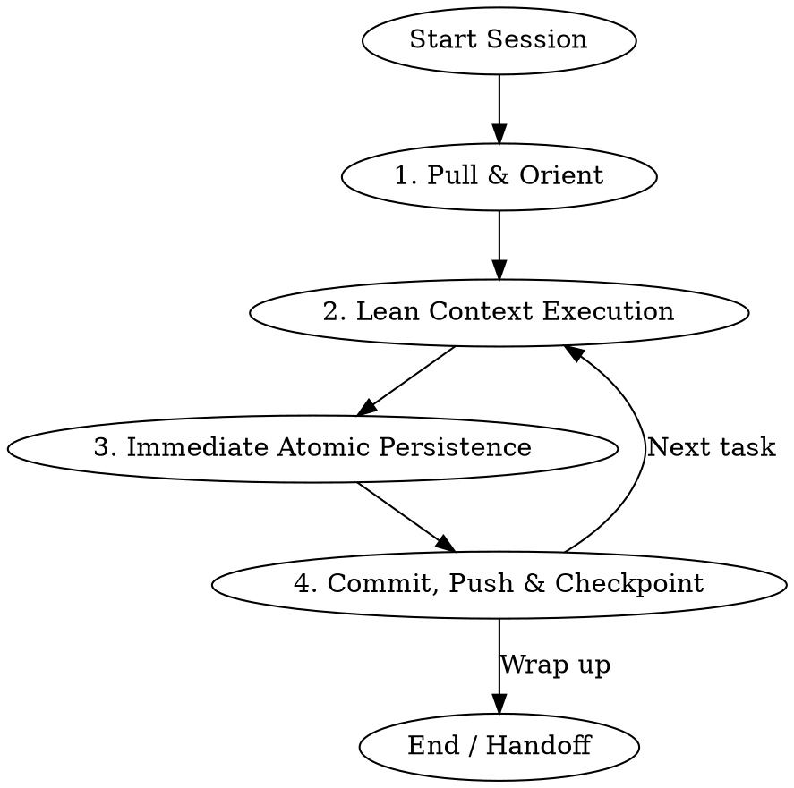

# Optimizing Sessions

## Overview

Session optimization ensures maximum productivity and continuity while preventing context window exhaustion, token bloat, and cross-device desynchronization.

**Core rule:** Chat memory is volatile; disk and git are permanent. Persist facts immediately, keep context lean, and sync continuously.

---

## When to Use

- Starting a new agent session or resuming after time away
- Context window approaches capacity or after a context truncation / summary event
- Working across multiple computers on shared branches (`main`)
- Executing long multi-turn workflows where token accumulation threatens memory
- Preparing to end a session or hand off work to a future session

**When NOT to use:**
- Trivial single-command questions with zero repo changes or state tracking

---

## The 4 Pillars of Session Optimization

### 1. Fast Orient & Pull (Startup)
Never guess the project state or start modifying files before syncing.
1. **Always pull first:** Run `git pull origin main` immediately.
2. **Lightweight log inspection:** Run `git log -n 5 --oneline` and `git status`.
3. **Targeted issue check:** Use bounded CLI queries with `--limit` and `jq` filters (e.g. `gh issue list --limit 5` or `gh project item-list 1 --owner magnuskiro`).
   * ❌ **Never** dump hundreds of unfiltered JSON lines or all comments into context.
   * ✅ **Filter** for the exact fields needed (`title`, `state`, `last_comment`).

### 2. Context & Token Hygiene (During Work)
Token bloat leads to premature context truncation and amnesia.
1. **Surgical inspection:**
   * Use `view_file` with `StartLine` and `EndLine` slices instead of loading entire 800-line files.
   * Use `grep_search` with specific paths/patterns instead of sweeping the whole workspace.
2. **Delegate heavy research to subagents:**
   * When exploring multiple unfamiliar directories, browsing many web pages, or reading large specs, invoke a `research` subagent via `invoke_subagent`.
   * Subagents absorb the token heavy lifting and return only the distilled findings, keeping the primary agent's context clean.
3. **Reactive wakeup over polling:**
   * Never poll `run_command` in a loop with sleep. Rely on the system's reactive notifications.

### 3. Immediate Atomic Persistence (Compaction Immunity)
If the conversation history is truncated or restarted, anything stored *only* in chat messages is lost.
1. **Write to disk immediately:**
   * Technical facts, calculations, verified numbers, and zoning rules belong in `notebooklm/sources/` or `docs/`.
   * Task state and user clarifications belong in GitHub issue descriptions or comments.
2. **Immunity principle:**
   * If a session gets truncated right now, can the next prompt recover 100% of the state from `git log` and docs? If yes, the session is resilient.

### 4. Immediate Git Synchronization (Multi-Device Safety)
When collaborating across multiple physical machines on `main`:
1. **Atomic commits:** Stage and commit immediately after completing each logical file edit or sub-task.
2. **Immediate push:** Run `git push origin main` right after committing. Never leave unpushed commits sitting on one machine while switching to another.
3. **Descriptive messages:** Use conventional commit syntax (`docs(zoning): ...`, `fix(mur): ...`, `feat(nord): ...`).

---

## Session Wrap-Up & Checkpoint Checklist

Before finishing a session, complete this quick 4-step checklist:

| Step | Action | Command / Verification |
| :--- | :--- | :--- |
| **1. Clean Tree** | Verify no uncommitted modifications | `git status` (must report "working tree clean") |
| **2. Pushed State** | Ensure local `main` is up to date with remote | `git status` (must report "up to date with origin/main") |
| **3. Issue Log** | Post relevant milestones/measurements to GitHub issue | `gh issue comment <ID> --body "..."` |
| **4. Handover Note** | Provide a crisp 3-point summary in the final chat message | • **Fullført i sesjonen** • **Aktiv status / Blokkeringer** • **Neste prioriterte steg** |

---

## Common Anti-Patterns to Avoid

| ❌ Anti-Pattern | Why It Fails | ✅ Correct Approach |
| :--- | :--- | :--- |
| **Dumping raw logs into context** | Consumes 10k–50k tokens in a single command, speeding up truncation. | Pipe through `jq` or use `--limit` to view only essential fields. |
| **Chat-only documentation** | Numbers, specs, and agreements vanish when context is compacted. | Commit findings into markdown docs and issue comments immediately. |
| **Batching commits at the end** | Risk of merge conflicts, lost work across computers, and unpushed drift. | Commit and push after every completed edit. |
| **Editing without pulling** | Inevitable fast-forward rejection when working across multiple devices. | `git pull origin main` before touching any code. |
