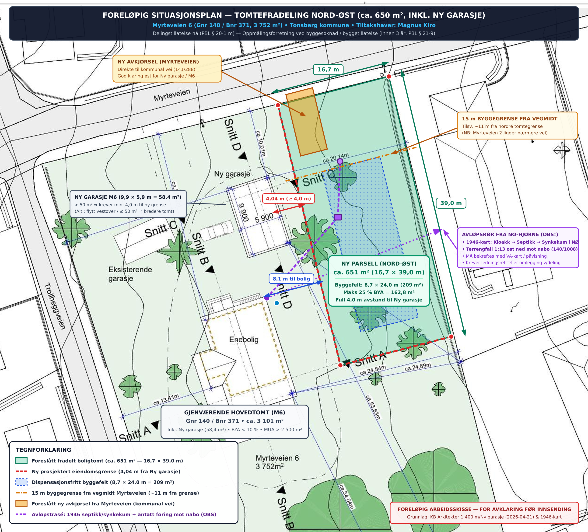

# Søknadsunderlag — Tomtefradeling Nord-Øst (ca. 650 m²)

**Eiendom:** Myrteveien 6, 3152 Tolvsrød — **Gnr 140 / Bnr 371**, Tønsberg kommune  
**Tiltakshaver / Hjemmelshaver:** Magnus Kirø  
**Tiltak:** Oppretting av ny grunneiendom (fradeling av ubebygd boligtomt på ca. **650 m²** i nordøstlig hjørne) jf. **PBL § 20-1 første ledd bokstav m**  
**Status:** Arbeidsutkast & søknadspakke (klar for beslutningspunkter, VA-avklaring og nabovarsling)  
**Dato:** 26. november 2026  

---

## 1. Strategi for oppmåling: Delingstillatelse nå, oppmåling ved byggesøknad / byggetillatelse

Et sentralt ønske er å få **formell godkjenning for fradeling nå**, men å **utsette selve oppmålingsforretningen** til byggesøknad sendes inn eller byggetillatelse foreligger.

### Anbefalt juridisk spor (Hovedalternativ): Ren delingssøknad uten samtidig rekvisisjon
En fradeling i norsk rett består av **to adskilte trinn** etter to ulike lover:
1. **Delingstillatelse (PBL § 20-1 første ledd bokstav m & § 20-4):** Behandles av byggesaksavdelingen i Tønsberg kommune (maks **12 ukers** saksbehandlingstid for komplett søknad). Tiltaket krever **ikke ansvarlig foretak** — hjemmelshaver søker selv.
2. **Oppmålingsforretning og matrikkelføring (Matrikkellova § 6):** Kreves først når man ønsker at kommunens landmåler skal måle opp, merke grensene i marka og opprette det nye bruksnummeret (eget gebyr og 16 ukers frist etter rekvisisjon).

**Slik fungerer 3-årsregelen (PBL § 21-9 fjerde ledd):**
> *«Tillatelse til oppretting eller endring av matrikkelenhet faller bort dersom det ikke er rekvirert oppmålingsforretning etter matrikkellova innen 3 år etter at tillatelsen ble gitt.»*

**Konkrete fordeler med å kun søke delingstillatelse nå og rekvirere oppmåling senere:**
- **Du binder ikke kapital i oppmålingsgebyr nå:** Du betaler kun byggesaksgebyret for selve delingssøknaden i første omgang. Oppmålings- og matrikkelføringsgebyret påløper først når rekvisisjon sendes inn.
- **3 fulle års handlingsrom (mot kun maks 2 år ved MUF):** Dersom man rekvirerer samtidig og søker om *matrikulering uten fullført oppmålingsforretning* (MUF, jf. matrikkellova § 6 andre ledd), kreves «særlige grunner» og kommunen setter en absolutt frist på **maks 2 år** (matrikkelforskriften § 25). Ved å avvente rekvisisjonen får man **3 fulle år** etter lovens hovedregel.
- **Ingen ødelagte grensemerker under anleggsarbeid på M6:** Grunnarbeider nord (`#92`) og ombygging av hovedbolig kan gjennomføres uten at nyutsatte grensebolter/rør graves opp eller skades.
- **Forutsigbarhet før arkitektkostnader:** Delingsvedtaket låser prinsippet om at tomten er godkjent fradelt til boligformål etter gjeldende plan (KPA 2023–2035) før du bruker penger på detaljprosjektering av ny bolig.

> **OBS — Praktisk håndtering overfor Tønsberg kommune:**  
> På Tønsberg kommunes nettsider anbefales det ofte som standard rutine å sende inn *Søknad om tillatelse til tiltak uten ansvarsrett* og *Rekvisisjon av oppmålingsforretning* samtidig. I følgebrevet (se del 4) presiserer vi derfor **eksplisitt** at det i denne omgang **kun søkes om delingstillatelse etter PBL § 20-1 første ledd bokstav m**, og at *Rekvisisjon av oppmålingsforretning* ettersendes særskilt i forbindelse med byggesøknad/byggetillatelse innen 3-årsfristen i PBL § 21-9 fjerde ledd.  
> *(Dersom du senere ønsker å selge eller pantsette tomten med eget bnr. før bygging, kan rekvisisjon sendes inn når som helst innen 3-årsfristen.)*

---

## 2. Geometri-, plan- og reguleringsanalyse

### 2.1 Plangrunnlag
- **Reguleringsstatus:** Uregulert område (eldre, etablert småhusområde på Tolvsrød/Slagen).
- **Gjeldende plan:** **Kommuneplanens arealdel 2023–2035 for Tønsberg kommune** (PlanID `3803 99010`, vedtatt 03.04.2024).
- **Arealformål:** *Nåværende boligbebyggelse* (jf. KPA § 3 nr. 2). Ingen hensynssoner for veiutvidelse, landbruk eller båndlegging berører parsellen.
- **Plankrav:** Oppretting av én ny boligtomt med direkte avkjørsel til eksisterende kommunal vei (Myrteveien) utløser **ikke** krav om detaljregulering (plankrav i uregulert boligområde inntrer først ved mer enn 2 boenheter eller krav om ny adkomstvei/vesentlig veiutbedring).

### 2.2 Anbefalt tomtegeometri inkl. Ny garasje (`16,7 m × 39,0 m = ca. 651 m²`)
Kalibrert direkte mot Kartverkets matrikkeldata (`140/371`: 3 752 m², nordgrense 51,89 m, østgrense mot `140/1008` 42,77 m) og KB Arkitekters situasjonsplan **med Ny garasje** (`2026-04-21`, `assets/images/drawings/situasjonsplan-1.jpg`):

- **Ny garasje på M6 (`A-105PS`):** `9,9 m × 5,9 m` = **58,4 m² BYA** (`51,2 m² BRA`: 34,7 m² garasje + 16,5 m² bod), plassert **ca. 20,74 m** fra østgrensen mot `140/1008` og **ca. 10,01 m** fra Myrteveien.
- Fordi garasjen er **over 50 m²**, utløser den hovedregelen om **min. 4,0 m avstand til ny nabogrense** (PBL § 29-4). Ved å sette bredden på den nye parsellen til **16,7 m** langs Myrteveien og dybden til **39,0 m** langs østgrensen mot `140/1008` får man **4,04 m** lovlig avstand fra Ny garasje uten å flytte eller redusere garasjen!

| Parameter | Foreslått ny parsell (NØ) | Gjenværende M6 (140/371) | Regelverk / Grense | Status |
| :--- | :---: | :---: | :--- | :---: |
| **Tomteareal** | **ca. 651 m²** (16,7 × 39,0 m) | **ca. 3 101 m²** | Veiledende min. 500 m² (enebolig) / 750 m² (tomannsbolig) | ✅ OK for enebolig *(se OBS 2.4)* |
| **Avstand Ny garasje (58,4 m²) → ny grense** | — | **4,04 m** (fra østvegg garasje) | Min. 4,0 m for bygg > 50 m² (PBL § 29-4) | ✅ OK (ingen dispensasjon) |
| **Avstand M6 bolig → ny grense** | — | **8,1 m** (fra østvegg bolig) | Min. 4,0 m (PBL § 29-4 / TEK17 § 11-6) | ✅ OK (god margin) |
| **Avstand M6 overvannskum → ny grense** | — | **~6,9 m** inne på M6 | Blir liggende på M6 | ✅ OK |
| **Østgrense mot `140/1008` (Myrteveien 2)** | **39,0 m** (av 42,77 m) | Beholder søndre grense | Treffer kun `140/1008` (ikke `140/995`) | ✅ Rent grenseforløp |
| **Dispensasjonsfritt byggefelt (ny tomt)** | **8,7 × 24,0 m = 209 m²** | Rikelig | 4,0 m til nabogrenser + 15 m fra vegmidt Myrteveien (~11 m fra nordgrense) | ✅ OK (ingen dispensasjon) |
| **Tillatt maks %BYA (25 %, KPA § 44.1)** | **162,8 m²** (f.eks. 126 m² bygg + 36 m² for 2 p-plasser) | **775,3 m²** (bolig + 58,4 m² garasje + p-plasser ≈ 260–310 m² = **< 10 %**) | Maks 25 % BYA inkl. 18 m² per p-plass | ✅ OK på begge tomter |
| **Minste uteoppholdsareal (MUA)** | **~488 m²** ubebygd (godt over 150 m²) | **> 2 500 m²** ubebygd | Min. 150 m² per boenhet (enebolig) | ✅ OK på begge tomter |
| **Atkomst / Avkjørsel (PBL § 27-4)** | Direkte til kommunal vei (**Myrteveien**, 141/288) | Beholder egen avkjørsel mot Myrteveien | Siktsoner & bredde iht. Tønsberg veinormal | ⚠️ Avklares mot vegmyndighet |
| **Vann, avløp & overvann (PBL §§ 27-1, 27-2)** | Tilkobling kommunalt VA (Myrteveien el. øst/felles) + LOD | **OBS: Eksisterende avløpsrør fra NØ-hjørne mot nabo!** | Ledningskart, påvisning & ev. tinglyst ledningsrett / omlegging | ⚠️ **KRITISK — se punkt 2.3** |
| **Sikker byggegrunn (PBL § 28-1)** | Grunt til fjell (0,2–1,5 m), K3 OK | Grunt til fjell, K3 OK | GrunnTeknikk notat `10220n1` (04.05.2026) | ⚠️ Rette skrivefeil s. 9 + utvide scope |

> **Alternativ bredere tomt (opsjon dersom Ny garasje justeres):**  
> Dersom du ønsker bredere tomt enn 16,7 m (f.eks. **19,5 × 33,3 m** eller **20,0 × 32,5 m = 650 m²**, som gir 11,5–12,0 m bredde på byggefeltet), kan dette oppnås på én av tre måter:
> 1. **Forskyve Ny garasje ~3,3 m vestover** (den er ennå ikke bygget og ligger i dag hele 24,63 m fra Trollheggveien — fullt 4,0 m-krav beholdes).
> 2. **Redusere Ny garasje til ≤ 50 m² BYA/BRA** (KPA § 19 tillater da inntil **1,0 m** til nabogrense → opptil ~19,7 m bredde).
> 3. **Tinglyst nabosamtykke** (du eier begge tomtene selv ved deling, men vær obs på brannavstand 8 m mot fremtidig ny bolig / ev. EI 30/60 på garasjevegg).

### 2.3 Kritisk funn: Eksisterende avløpsrør fra nordøst-hjørnet av dagens hus ned mot naboen
Ved gjennomgang av kommunalt saksarkiv i repoet er det funnet dokumentasjon på det opprinnelige avløpsanlegget:
- **Kilde:** `arkitekt/kommunale_byggesaker/1946_Kart_og_skisse_Gnr140_Bnr371.pdf` (Sem bygn.råd J.nr. 814/1946, datert 26. juni 1946 — *merk at kartet er tegnet med nord ned og østgrensen mot dagens Myrteveien 2 `140/1008` til venstre*).
- **Funn på 1946-kartet:** En blå avløpsledning går rett ut fra **nordøst-hjørnet av dagens hus**, diagonalt mot nord-øst inn i det området som nå ønskes fradelt, til **`KLOAKK. SEPTIKK`** (ca. 11–13 m NØ for husets NØ-hjørne) og videre nordover til **`SYNKEKUM`**.
- **Dagens spillvannsledning ned mot naboen (`140/1008`):** Terrenget på Myrteveien 6 faller jevnt **ca. 1:13 østover** ned mot Myrteveien 2 (`140/1008`) og Øvre Bogenvei (jf. GrunnTeknikk `10220n1` s. 4). Det ligger foreløpig **ikke** noe moderne kommunalt VA-ledningskart i repoet som viser eksakt dagens trasé etter senere kommunal kloakktilkobling.
- **Konsekvenser som MÅ avklares før endelig grensefesting og innsending:**
  1. **Innhente offisielt VA-ledningskart + kabel-/rørpåvisning (ev. kamerakjøring / søkesonde):** Fastslå nøyaktig hvor aktiv spillvannsledning fra M6s NØ-hjørne går over parsellen og inn på naboeiendom (`140/1008` / `140/995`), samt om gammel septiktank/synkekum fra 1946 er sanert eller fortsatt ligger i grunnen.
  2. **Byggeforbud over aktiv ledning:** Ny bolig på 650 m²-tomten kan ikke plasseres over en aktiv avløpsledning (krav om typisk 2–4 m avstand eller omlegging). Med `16,7 × 39,0 m`-tomten er byggefeltet hele **24,0 m dypt**, slik at ny bolig likevel kan plasseres klart nord eller sør for ledningen — eller ledningen legges om langs den nye sørgrensen/vestgrensen.
  3. **Tinglyst ledningsrett (PBL § 27-2):** Dersom M6s avløpsledning fortsatt skal krysse den nye parsellen (og nabotomten), krever kommunen **tinglyst rett til å ha liggende og vedlikeholde avløpsledning** over den nye parsellen ved matrikulering/fradeling (og avklaring av eksisterende rett over `140/1008`).
  4. **Mulig bonus for ny tomt:** Dersom det ikke er selvfall fra den nye parsellen nordover til kommunal ledning i Myrteveien, kan en oppgradert felles stikkledning i dagens trasé (med selvfall østover) være nøkkelen for avløpsløsning også for den nye tomten — forutsatt dokumentert rettighet og kapasitet videre ned mot kommunalt nett.

### 2.4 Øvrige avklaringspunkter før innsending
1. **Enebolig (650 m²) vs. Tomannsbolig (750 m²):**
   - I tidligere arkitektnotat (`2024-01-09`) ble det nevnt *«Skille ut tomt mot nor-øst, tegne 2-mannsbolig der»*.
   - Tønsberg kommunes veiledende retningslinjer for tomtestørrelse ved fradeling er **minst 500 m² for enebolig** og **minst 750 m² for tomannsbolig**.
   - **Anbefaling:** Dersom målet er en **enebolig** (ev. med sekundærleilighet innenfor én grunneiendom), er **650 m²** ideelt og lett å få godkjent. Dersom det er aktuelt å bygge **tomannsbolig** (2 hovedboenheter), bør man vurdere å forlenge dybden mot sør med 5 m til **20,0 m × 37,5 m = 750 m²** (østgrensen mot `140/1008` er 42,77 m, så det er god plass!).
2. **Geoteknisk notat `10220n1` (GrunnTeknikk AS, 04.05.2026):**
   - Notatet konkluderer allerede med at hele eiendommen Myrteveien 6 (Gnr 140 / Bnr 371) har grunt fjell (0,2–1,5 m) og at krav til sikkerhet mot områdeskred (tiltakskategori K3, NVE veileder 1/2019) er innfridd.
   - **To små ting som bør rettes før vedlegging:**
     1. På kontrollsiden (side 9) står det ved en feil *«Kommune: Færder»* i stedet for **Tønsberg**.
     2. I kapittel 1/2 bør GrunnTeknikk AS gi en kort skriftlig bekreftelse (ev. rev. 01) på at vurderingen også omfatter **fradeling av ny boligtomt i nordøstlig del av Gnr 140 / Bnr 371**.
3. **Kommunalt VA-nett i Myrteveien:**
   - Må bestille offisielt **VA-ledningskart** og innhente **forhåndsuttalelse fra Tønsberg kommune (Vann og avløp)** som bekrefter tilkoblingspunkt for vann og spillvann i Myrteveien (slik at man dokumenterer PBL §§ 27-1 og 27-2 uten behov for tinglyst ledningsrett over naboeiendom).
4. **Avkjørselstillatelse (Myrteveien — kommunal vei, Gnr 141/288):**
   - Søknaden må vise eksakt plassering av ny avkjørsel og frisiktsoner mot Myrteveien (må holdes klar av lyktestolpe og M6s innkjøring). Kommunal vegmyndighet uttaler seg internt i saken eller via egen avkjørselssøknad.
5. **Vegetasjon / Trær i nord-øst:**
   - Situasjonsplanen viser enkelte større trær i nordøst-hjørnet. Det er ikke registrert reguleringsmessig trevern, men bevaring/skjøtsel av randvegetasjon mot `140/1008` bør omtales positivt for å unngå nabomerknader.
6. **Heftelser / Panthavere:**
   - Sjekk grunnboken (Kartverket / Seeiendom) for eventuelle tinglyste servitutter (f.eks. delingsforbud / villaklausul fra 1946!) eller pantheftelser før tinglysing. *(Obs: Frafall/relaksasjon av pant kreves først ved selve skjøting/matrikulering, ikke for delingstillatelsen etter PBL — men en eventuell tinglyst villaklausul/delingsforbud bør sjekkes tidlig!)*

---

## 3. Komplett sjekkliste for søknadspakken (Tønsberg kommune)

Søknaden sendes digitalt via **DiBKs søknadsløsning (eByggesøk / ByggSøk)** eller til `postmottak@tonsberg.kommune.no` (sjekk at digital innsending via godkjent søknadsløsning benyttes for raskest behandling).

- [ ] **1. Søknadsskjema:** *Søknad om tillatelse til tiltak uten ansvarsrett* (DiBK 5153 / digitalt skjema — kryss av for *«Oppretting av ny grunneiendom»* / deling). *(Ingen ansvarsretter kreves.)*
- [ ] **2. Redegjørelse / Søknadsbrev** (utkast i del 4 nedenfor) — inkl. eksplisitt presisering av at oppmålingsforretning **ikke** rekvireres nå, men ettersendes innen 3 år (PBL § 21-9 fjerde ledd) ved byggesøknad/byggetillatelse.
- [ ] **3. Offisielt situasjonskart (1:500 eller 1:1000)** hentet fra Tønsberg kommunes kartportal / Ambita Infoland, påtegnet:
  - [ ] Prosjekterte nye eiendomsgrenser med lengder (16,7 m × 39,0 m) og areal (ca. 651 m²).
  - [ ] Minsteavstand til planlagt Ny garasje på M6 (**4,04 m**), eksisterende bolig (**8,1 m**) og nabogrenser.
  - [ ] Foreslått plassering av ny avkjørsel fra Myrteveien + frisikttrekanter.
  - [ ] Illustrativt byggefelt (8,7 × 24,0 m = 209 m²) som dokumenterer egnethet (PBL § 26-1), %BYA, parkering og MUA.
  - [ ] Innhentet og påvist trasé for eksisterende avløpsrør fra M6s NØ-hjørne mot naboen (`140/1008`) samt plan for tinglyst ledningsrett eller omlegging.
- [ ] **4. Nabovarsling (PBL § 21-3, min. 14 dagers frist):**
  - [ ] Offisiell naboliste bestilt via eTorg / Infoland (kontrollert mot del 5 nedenfor).
  - [ ] *Nabovarsel* (DiBK 5154) sendt til alle direkte grensenaboer og gjenboere.
  - [ ] *Opplysninger gitt i nabovarsel* (DiBK 5155) + *Kvittering for nabovarsel* (DiBK 5156).
  - [ ] Eventuelle nabomerknader + tiltakshavers kommentar.
- [ ] **5. VA- og overvannsdokumentasjon:**
  - [ ] Kommunalt VA-ledningskart og/eller forhåndsuttalelse fra Tønsberg kommune VA om tilkoblingsmulighet i Myrteveien.
  - [ ] Kort prinsippbeskrivelse for lokal overvannshåndtering (LOD 3-trinnsstrategi jf. KPA § 27).
- [ ] **6. Avkjørselsplan:**
  - [ ] Avklaring/søknad om ny avkjørsel fra kommunal vei Myrteveien (Gnr 141/288) iht. Tønsberg veinormal.
- [ ] **7. Geoteknisk dokumentasjon:**
  - [ ] GrunnTeknikk AS notat `10220n1` (oppdatert med «Kommune: Tønsberg» på kontrollsiden og bekreftelse for NØ-parsell).
- [ ] **8. Grunnboksutskrift (intern sjekk):**
  - [ ] Verifisere at ingen tinglyste servitutter (delingsforbud) hindrer fradeling.

---

## 4. Utkast til søknadsbrev / Redegjørelse (Følgebrev)

> *Klar til gjennomlesing, eventuelle justeringer (f.eks. 650 vs. 750 m²) og vedlegging i søknaden.*

---

**Til:** Tønsberg kommune — Virksomhet byggesak og arealforvaltning  
**E-post / innsending:** Digital byggesøknad / `postmottak@tonsberg.kommune.no`  
**Fra:** Magnus Kirø (hjemmelshaver og tiltakshaver), Myrteveien 6, 3152 Tolvsrød  
**Dato:** [DD.MM.ÅÅÅÅ]  

**Vedrørende: Søknad om delingstillatelse (oppretting av ny grunneiendom på ca. 650 m²) — Gnr 140 / Bnr 371, Myrteveien 6, 3152 Tolvsrød**

### 1. Beskrivelse av tiltaket
Undertegnede er hjemmelshaver til eiendommen Myrteveien 6, Gnr 140 / Bnr 371 i Tønsberg kommune, med samlet matrikkelareal på **3 752 m²**.

Det søkes med dette om **delingstillatelse etter plan- og bygningsloven (PBL) § 20-1 første ledd bokstav m**, jf. § 20-4, for fradeling av én ny, ubebygd boligtomt i eiendommens nordøstlige hjørne mot Myrteveien:

- **Ny parsell (nord-øst):** Ca. **651 m²** (ca. 16,7 m bredde langs Myrteveien × ca. 39,0 m dybde langs eksisterende østgrense mot Gnr 140 / Bnr 1008). Formål: Frittliggende enebolig.
- **Gjenværende hovedeiendom (Gnr 140 / Bnr 371):** Ca. **3 101 m²**, med eksisterende enebolig, planlagt ny garasje (58,4 m²) og hageareal.

### 2. Særskilt merknad om tidspunkt for oppmålingsforretning (PBL § 21-9 fjerde ledd)
Det gjøres uttrykkelig oppmerksom på at det i denne omgang **kun søkes om tillatelse til deling etter plan- og bygningsloven**. *Rekvisisjon av oppmålingsforretning og krav om matrikkelføring* etter matrikkellova vedlegges **ikke** nå.

Bakgrunnen er at tiltakshaver planlegger å rekvirere oppmålingsforretning og gjennomføre fysisk merking i marka først **ved innsending av byggesøknad for ny bolig eller når byggetillatelse foreligger** — og selvsagt innen lovens 3-årsfrist fra delingstillatelse, jf. **PBL § 21-9 fjerde ledd**. På gjenværende eiendom (Myrteveien 6) planlegges det dessuten grunn- og rehabiliteringsarbeider i nærliggende sone, slik at utsettelse av grensemerking er både praktisk og hensiktsmessig.

### 3. Forholdet til plangrunnlag og tomteegnethet (PBL § 26-1)
Eiendommen ligger i et uregulert, etablert småhusområde på Tolvsrød og er i **Kommuneplanens arealdel 2023–2035 (PlanID 3803 99010)** avsatt til *Nåværende boligbebyggelse*.

Tiltaket er i full overensstemmelse med kommuneplanens bestemmelser og krever ingen dispensasjoner:
- **Tomtestørrelse:** Ca. 650 m² overstiger kommunens veiledende minstekrav på 500 m² for frittliggende enebolig.
- **Utnyttingsgrad (KPA § 44.1, maks 25 % BYA):**
  - *Ny parsell (ca. 651 m²):* Maks tillatt BYA utgjør **162,8 m²**, noe som gir god plass til en frittliggende enebolig (f.eks. 110–125 m² fotavtrykk) samt 2 biloppstillingsplasser på terreng (36 m²).
  - *Gjenværende eiendom (ca. 3 101 m²):* Maks tillatt BYA utgjør **775,3 m²**. Eksisterende og planlagt bebyggelse inkl. ny garasje (58,4 m²) og parkering utgjør under 10 % BYA.
- **Plassering og avstander (PBL § 29-4 & Veglova § 29):**
  - Ny vestgrense trekkes **4,04 m** øst for planlagt ny garasje (58,4 m²) og **8,1 m** øst for eksisterende/planlagt bolig på Myrteveien 6, slik at lovens minsteavstand på 4,0 m er oppfylt uten dispensasjon.
  - Innenfor ny parsell oppstår et helt dispensasjonsfritt byggefelt på **8,7 m × 24,0 m (209 m²)** som respekterer både 4,0 m avstand til alle nabogrenser og 15,0 m byggegrense målt fra senterlinje kommunal vei (Myrteveien).
- **Uteoppholdsareal (MUA):** Ny parsell har et flatt til svakt skrånende, solrikt og skjermet uteareal mot sør/sørvest som med god margin overstiger kravet på min. 150 m² MUA per boenhet. Gjenværende tomt beholder over 2 500 m² hage- og uteareal.
- **Tilpasning til strøkskarakter (PBL § 29-2):** Omkringliggende bebyggelse langs Myrteveien (bl.a. Myrteveien 1, 2, 3 og 5) består av frittliggende eneboliger på sammenlignbare tomter. Fradeling av én ny tomt i det ubebygde nordøstlige hjørnet utgjør en skånsom og naturlig fortetting som viderefører strøkets struktur.

### 4. Atkomst, vann, avløp og overvann (PBL §§ 27-1, 27-2 og 27-4)
- **Atkomst / avkjørsel:** Ny parsell har ca. 20 m grense direkte mot kommunal vei (**Myrteveien**, Gnr 141/288). Det søkes om én ny avkjørsel i parsellens vestre del mot Myrteveien, plassert i god avstand (~8 m) øst for eksisterende veglys og hovedeiendommens egen innkjøring, med oversiktlige siktforhold i begge retninger iht. Tønsberg kommunes veinormal.
- **Vann og avløp:** Ny parsell tilkobles offentlig vann- og avløpsnett (jf. vedlagt VA-ledningskart / forhåndsuttalelse fra Tønsberg kommune VA). Eksisterende spillvannsledning fra Myrteveien 6s nordøstre hjørne er påvist/kartlagt *[fylles inn etter VA-kart og påvisning: sikres enten med tinglyst ledningsrett over ny parsell eller omlegges/samordnes som felles stikkledning utenfor byggefeltet]*.
- **Overvann (KPA § 27 — LOD):** Overvann fra fremtidig bebyggelse og tette flater skal håndteres lokalt på egen tomt etter kommunens 3-trinnsstrategi (infiltrasjon/fordrøyning i stenkiste/regnbed og trygg flomvei). Eksisterende overvannskum for Myrteveien 6 blir liggende på gjenværende hovedtomt.

### 5. Sikker byggegrunn og geoteknikk (PBL § 28-1, TEK17 § 7-3)
Eiendommen ligger delvis innenfor NVEs aktsomhetsområde for kvikkleireskred. Det er derfor utarbeidet et eget geoteknisk fagnotat for eiendommen av **GrunnTeknikk AS (Dok.nr. 10220n1, datert 04.05.2026)** i henhold til NVE veileder 1/2019 (tiltakskategori K3). Notatet konkluderer med at det er grunt til fast fjell (0,2–1,5 m), at det ikke foreligger noe mulig løsneområde for områdeskred som kan berøre eiendommen, og at kravet til sikkerhet mot områdeskred er innfridd.

### 6. Nabovarsling (PBL § 21-3)
Berørte naboer og gjenboere er varslet med 14 dagers merknadsfrist iht. vedlagt gjenpart av nabovarsel og kvitteringsliste. *[Oppdateres etter utsendt nabovarsel: Det har innkommet [ingen / X] merknader innen fristen.]*

Med vennlig hilsen  
**Magnus Kirø**  
Myrteveien 6, 3152 Tolvsrød  
Telefon: [Fyll inn] | E-post: [Fyll inn]  

**Vedlegg:**
1. Søknad om tillatelse til tiltak uten ansvarsrett (DiBK 5153)
2. Situasjonskart med påtegnet ny parsell, avstander, byggefelt og avkjørsel (M 1:500)
3. Gjenpart av nabovarsel, naboliste og kvittering (DiBK 5154/5155/5156)
4. VA-ledningskart / forhåndsuttalelse fra Tønsberg kommune VA
5. Geoteknisk notat områdestabilitet — GrunnTeknikk AS (Dok.nr. 10220n1, rev. 01)

---

## 5. Nabovarsling — Naboliste og utkast til varslingstekst

Basert på offisiell matrikkeloversikt fra `#90` (`assets/images/nabokart_m6.png`). *(Merk: Bestill alltid fersk naboliste fra kommunen/Infoland ved utsending for å sikre oppdaterte hjemmelshavere og digitale postkasser.)*

### 5.1 Naboer og gjenboere som skal varsles
| Kategori | Gnr / Bnr | Adresse / Eiendom | Relasjon til tiltaket |
| :--- | :---: | :--- | :--- |
| **Direkte grensenabo** | **140/1008** | Myrteveien 2 | Deler hele østgrensen (39,0 m) med den nye parsellen *(viktigste nabo — også ift. ev. eksisterende avløpstrasé!)* |
| **Direkte grensenabo** | **140/995** | Øvre Bogenvei 31 | Direkte grensenabo til 140/371 mot sørøst |
| **Direkte grensenabo** | **140/1014** | Øvre Bogenvei 33B | Direkte grensenabo til 140/371 mot sør |
| **Direkte grensenabo** | **140/1247** | Trollheggveien 8 (tomt) | Direkte grensenabo til 140/371 mot sør |
| **Direkte grensenabo** | **141/1** | Ulvikveien 23A / veigrunn Trollheggveien | Direkte grensenabo mot sørvest / vest |
| **Veigrunn / Kommune** | **141/288** | Myrteveien (kommunal vei) | Tønsberg kommune som veieier mot nord |
| **Gjenboer over vei** | **140/361** | Myrteveien 1 | Rett over Myrteveien mot nordøst |
| **Gjenboer over vei** | **140/762** | Myrteveien 3 | Rett over Myrteveien mot nord |
| **Gjenboer over vei** | **140/373** | Trollheggveien 6 | Over Myrteveien mot nordvest |
| **Gjenboer over vei** | **141/25** | Myrteveien 5A / 5B | Over Myrteveien mot nordvest |
| **Gjenboer over vei** | **141/276** | Myrteveien 8A | Over Trollheggveien mot vest |
| **Gjenboer over vei** | **141/46** | Trollheggveien 7 | Over Trollheggveien mot vest |
| **Gjenboer over vei** | **141/65** | Trollheggveien 9 | Over Trollheggveien mot vest |

### 5.2 Utkast til beskrivelse i nabovarselet (DiBK 5154)
> **Beskrivelse av tiltaket:**  
> Det søkes om delingstillatelse (fradeling av ubebygd boligtomt) fra eiendommen Myrteveien 6, Gnr 140 / Bnr 371 (totalt 3 752 m²). Den nye tomten plasseres i eiendommens nordøstlige hjørne mot Myrteveien og Myrteveien 2 (Gnr 140 / Bnr 1008), med et areal på ca. **651 m²** (ca. 16,7 m × 39,0 m). Gjenværende hovedeiendom blir ca. 3 101 m².  
>  
> Fradelingen er i tråd med Tønsberg kommunes kommuneplan (nåværende boligbebyggelse) og krever **ingen dispensasjoner**. Ny tomt får egen avkjørsel direkte fra Myrteveien. Det søkes i denne omgang kun om selve delingstillatelsen; oppmåling og eventuell fremtidig byggesøknad på den nye tomten vil bli varslet og behandlet særskilt på et senere tidspunkt.  
>  
> **Frist for merknader:** Minimum 14 dager fra mottak av varselet. Eventuelle merknader sendes til tiltakshaver Magnus Kirø ([e-post/adresse]).

---

## 6. Anbefalt fremdriftsplan (Neste steg)

1. **Beslutning om tomtestørrelse & formål (Uke 1):** Avklare endelig om parsellen skal være **650 m² (enebolig)** eller eventuelt utvides sørover til **750 m²** for å holde døren åpen for **tomannsbolig**.
2. **Innhente grunnlagsdata (Uke 1–2):**
   - Bestille fersk situasjonskartpakke, VA-ledningskart og offisiell naboliste (Tønsberg kommune / Infoland / eTorg).
   - Sjekke grunnboken for `140/371` for eventuelle tinglyste servitutter / delingsforbud.
   - Be GrunnTeknikk AS om en kjapp korreksjon av «Kommune: Færder» → «Tønsberg» på side 9 i notat `10220n1` + bekreftelse på at NØ-fradeling er dekket.
   - Ta en uformell prat med nærmeste nabo i **Myrteveien 2 (`140/1008`)** før formelt nabovarsel sendes ut.
3. **Nabovarsling (Uke 2–4):** Sende digitalt nabovarsel via eByggesøk / Altinn (14 dagers lovpålagt frist).
4. **Innsending av delingssøknad (Uke 4–5):** Sende komplett søknad om delingstillatelse (uten rekvisisjon av oppmålingsforretning) til Tønsberg kommune.
5. **Kommunal saksbehandling (Inntil 12 uker):** Vedtak om delingstillatelse.
6. **Senere — innen 3 år fra vedtak (PBL § 21-9):** Sende inn *Rekvisisjon av oppmålingsforretning og matrikkelføring* samtidig med byggesøknad eller når byggetillatelse foreligger.
