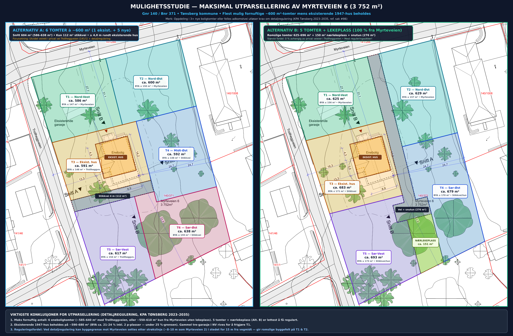
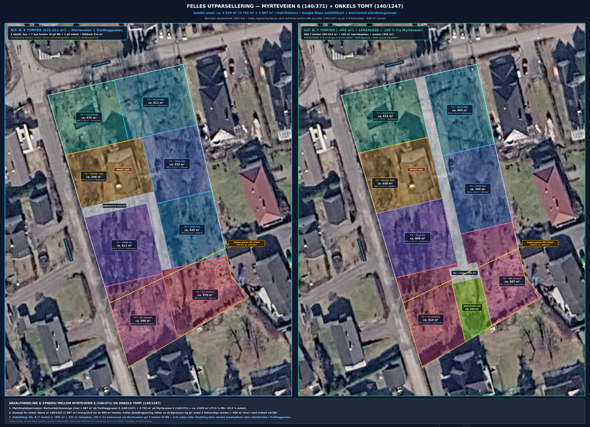

# Mulighetsstudie — Maksimal utparsellering av Myrteveien 6 (5–6 tomter à ~600 m²)

**Eiendom:** Myrteveien 6, 3152 Tolvsrød — **Gnr 140 / Bnr 371**, Tønsberg kommune  
**Samlet tomteareal:** **3 752 m²** *(nord: 51,9 m mot Myrteveien • vest: 80,9 m mot Trollheggveien • øst: 70,5 m • sør: 47,7 m)*  
**Forutsetning:** Beholde eksisterende **1947-enebolig** (fotavtrykk ca. 105 m²) med lovlig avstand og dele opp eiendommen i flest mulig fornuftige, byggbare boligtomter på **ca. 600 m²**.  
**Dato:** 26. november 2026  

---

## 1. Hovedkonklusjon: Hvor mange ~600 m²-tomter er fornuftig mulig?

Teoretisk gir `3 752 m² / 600 m² = 6,25 tomter`. Når man tar hensyn til plasseringen av det eksisterende 1947-huset (`27,3 m` sør for Myrteveien og `13,3 m` øst for Trollheggveien), lovlige byggeavstander (`≥ 4,0 m`), felles adkomstvei og Tønsberg kommunes krav til utnyttelse (`≤ 25 % BYA`), uteoppholdsareal (`≥ 150 m² MUA`) og nærlekeplass, lander man på **to sterke hovedalternativer** (pluss en hybrid):

| Alternativ | Antall tomter (inkl. eksist. hus) | Tomtestørrelser | Felles vei / snutun | Felles nærlekeplass | Avhengig av privat veirett i Trollheggveien? | Vurdering |
| :--- | :---: | :---: | :---: | :---: | :---: | :--- |
| **Alt. A — Maks antall (~600 m²)** | **6 tomter** *(1 eksist. + 5 nye)* | **586–638 m²** *(snitt 604 m²)* | 112 m² *(kort 4 m stikkvei)* | Kan tas ut (~150 m² fra T5/T6 → snitt ~580 m²) | **JA** *(krever avtale med veieier `141/1`)* | **Høyest antall fullverdige ~600 m²-tomter** |
| **Alt. B — Mest reguleringssikker (Anbefalt ved regulering)** | **5 tomter** *(1 eksist. + 4 nye)* | **625–696 m²** *(snitt 664 m²)* | 276 m² *(4 m stikkvei + snutun fra Myrteveien)* | **~150 m²** *(solrik syd-midt)* | **NEI** *(100 % fra kommunal vei Myrteveien)* | **Minst juridisk risiko, full pott på lekeplass & snutun** |
| **Alt. A2 — 6 tomter kun fra Myrteveien** | **6 tomter** *(1 eksist. + 5 nye)* | **~550–610 m²** *(snitt 580 m²)* | ~244 m² *(sentral stikkvei + snutun)* | Stramt *(krever ev. reduksjon til ~530–570 m²)* | **NEI** *(100 % fra Myrteveien)* | Mulig, men trangere i østre rekke og strammere for lekeplass |

---

## 2. Detaljert tomteoversikt

### Alternativ A: 6 tomter à ~600 m² (Myrteveien + Trollheggveien)
Utnytter at eiendommen har veifront både langs hele nordsiden (**51,9 m** mot Myrteveien) og hele vestsiden (**80,9 m** mot Trollheggveien), slik at intern stikkvei reduseres til et minimum (**112 m²**):

| Tomt | Plassering | Areal | Maks 25 % BYA | Atkomst | Merknad |
| :--- | :--- | :---: | :---: | :--- | :--- |
| **T1** | Nord-Vest (hjørnetomt) | **ca. 586 m²** | 146 m² | Direkte fra Myrteveien | Eksisterende gammel tre-garasje i NV rives |
| **T2** | Nord-Øst | **ca. 600 m²** | 150 m² | Direkte fra Myrteveien | Ligger rett ved 2014 VA-kum (~3 m fra østgrense) |
| **T3** | **Midt-Vest (Eksist. 1947-hus)** | **ca. 591 m²** | 148 m² | Direkte fra Trollheggveien | **Beholder eksist. hus** (~105 m² + 36 m² p-plass = ~23,8 % BYA). **≥ 4,0 m** til alle nye grenser! |
| **T4** | Midt-Øst | **ca. 592 m²** | 148 m² | Kort 4 m stikkvei | Flott, skjermet hagetomt med morgensol og 1:13 østhelling |
| **T5** | Sør-Vest | **ca. 617 m²** | 154 m² | Direkte fra Trollheggveien | Solrik sørvest-tomt (berører deler av trærne i sør) |
| **T6** | Sør-Øst | **ca. 638 m²** | 160 m² | Kort 4 m stikkvei | Største og mest usjenerte tomt i sørøst |
| *Vei* | *Felles stikkvei (4 m × 28 m)* | *ca. 112 m²* | — | *Fra Trollheggveien* | *Betjener T4 og T6 (ev. liten snuplass ved T4/T6)* |

> **Viktig om T3 (Eksisterende 1947-hus):** På 591 m² er det plass til dagens 1947-bolig (~105 m²) + 2 biloppstillingsplasser (36 m²) = ~141 m² (**23,8 % BYA**, under 25 %-grensen), men det gir lite rom for store tilbygg eller ny dobbelgarasje på T3. Skal T3 bygges ut med tilbygg/ny garasje, bør T3 ha ~680–750 m² (som i Alternativ B).

---

### Alternativ B: 5 romslige tomter + felles nærlekeplass (100 % fra Myrteveien)
Fjerner all avhengighet av privat veieier i Trollheggveien (`141/1`, Elisabeth Granøe) ved å legge én felles 4,0 m bred adkomstvei rett inn fra kommunal vei Myrteveien med ordentlig snutun/snuhammer i midten:

| Tomt | Plassering | Areal | Maks 25 % BYA | Atkomst | Merknad |
| :--- | :--- | :---: | :---: | :--- | :--- |
| **T1** | Nord-Vest | **ca. 625 m²** | 156 m² | Direkte fra Myrteveien / stikkvei | Gammel tre-garasje rives |
| **T2** | Nord-Øst | **ca. 629 m²** | 157 m² | Direkte fra Myrteveien / stikkvei | Svært byggbar form (~19,4 × 32,5 m) |
| **T3** | **Midt-Vest (Eksist. 1947-hus)** | **ca. 683 m²** | 171 m² | Felles stikkvei (eller Trollheggvn.) | God margin til både eksisterende hus, ev. carport/bod og skjermet vest/sør-hage |
| **T4** | Sør-Øst | **ca. 679 m²** | 170 m² | Felles stikkvei / snutun | Stor, solrik og usjenert boligtomt |
| **T5** | Sør-Vest | **ca. 696 m²** | 174 m² | Felles stikkvei / snutun | Stor, vestvendt tomt med kveldssol |
| *Lek* | *Felles nærlekeplass* | *ca. 150 m²* | — | *Tilknyttet snutunet i sør* | *Innfrir Tønsberg KPAs krav til lekeplass ved regulering* |
| *Vei* | *Felles stikkvei + snutun* | *ca. 276 m²* | — | *Fra kommunal vei Myrteveien* | *Plass for snuing av vare-/utrykningskjøretøy og felles VA-grøft* |

---

## 3. Plan- og regelverkskrav i Tønsberg kommune (KPA 2023–2035)

1. **Krav om detaljregulering (Plankrav — ref. sak `#86`):**
   - I uregulert boligområde (*Nåværende boligbebyggelse*, PlanID `3803 99010`) kan man kun fradele **1–2 nye boligtomter** uten reguleringsplan (og uten ny felles adkomstvei).
   - Oppdeling i **5–6 tomter** utløser derfor **krav om privat detaljregulering** (kostnad typisk ~250–450 000 kr + kommunalt plangebyr og 9–18 mnd. behandlingstid).
   - **Stor oppside ved regulering:** I en detaljregulering kan du selv regulere:
     - **Byggegrense mot Myrteveien (strøkslinje ca. 8–10 m fra veigrense)** på linje med nabohuset Myrteveien 2 — i stedet for uregulert 15 m fra vegmidt. Det gjør nordtomtene **T1 og T2** langt mer byggbare!
     - **Felles avkjørsel, snuhammer, felles renovasjonspunkt** ved Myrteveien (løser renovasjon for alle 5–6 tomtene på én gang!) og felles nærlekeplass.
     - **Utnyttingsgrad** (ev. søke 25–30 % BYA) og høyder/estetikk slik at utsikten og kvaliteten for alle tomtene optimaliseres.
2. **Trollheggveien (`141/1`, Elisabeth Granøe):**
   - Trollheggveien er en privat vei. En eksisterende veirett for én bolig gir normalt **ikke** automatisk rett til å koble på 3–5 nye boligtomter (jf. veglova § 53 / tingsrettslig tålegrense).
   - **Strategisk poeng:** Alternativ B (og A2) beviser at hele eiendommen kan utvikles til **5–6 tomter 100 % fra kommunal vei Myrteveien**, uten én eneste ny bil i Trollheggveien. Det gir et svært sterkt forhandlingskort dersom du likevel vurderer å forhandle med veieier om Alternativ A.
3. **Vann, avløp, overvann (LOD) & geoteknikk:**
   - **Geoteknikk:** GrunnTeknikk AS notat `10220n1` (04.05.2026) viser grunt fjell (0,2–1,5 m) og bekrefter områdestabilitet i tiltakskategori K3 (ved 5–6 boenheter kan detaljreguleringen falle inn under **K4** i NVE 1/2019, som fortsatt vil være uproblematisk på grunt fjell, men krever en kort oppdatering fra GrunnTeknikk).
   - **VA:** Felles stikkvei i Alternativ B fungerer også som én felles teknisk kulvert/grøft for vann, avløp, strøm og fiber til alle tomtene, med naturlig selvfall mot eksisterende 2014-kum/øst eller mot Myrteveien.

---

## 4. Sammenheng med pågående enkelt-fradeling i Nord-Øst (`#110`)

Dersom du først sender inn enkel fradelingssøknad for **én tomt i nord-øst (`#110`)** nå, og vil holde døren åpen for senere utparsellering av resten av eiendommen:
- **Pass på bredden på NØ-tomten (`#110`) og avkjørselen:** I Alternativ B starter den fremtidige felles stikkveien på `x = 28,5–32,5 m` (altså **`19,4 m` vest for østgrensen**).
- Den tegnede NØ-parsellen i `#110` (`17,2 m` bred ved Myrteveien, parallell vestgrense `4,05 m` øst for Ny garasje) ligger **helt øst for** den fremtidige stikkveikorridoren — så en enkelt-fradeling i NØ nå **låser IKKE ned** muligheten for senere stikkvei og utparsellering av resten av tomten!
- *(Eneste forbehold: Hvis du bygger Ny garasje nord på M6 først, vil den stå i veien for en fremtidig sentral stikkvei fra Myrteveien til de sørlige tomtene — da må adkomst enten gå via Trollheggveien [Alt. A] eller langs øst- eller vestkanten.)*

---

## 5. Utvidet mulighetsstudie: Felles utparsellering med onkels tomt i sydenden (`140/1247`)

### 5.1 Matrikkelgrunnlag (Kartverket / Geonorge API)
- **Myrteveien 6 (`140/371`):** Offisielt **3 752 m²** (Geonorge-polygon: 3 740 m²)
- **Onkels tomt i sydenden — Trollheggveien 8 (`140/1247`):** Geonorge-polygon viser **1 087 m²** *(ca. 1,1 mål — verdt å dobbeltsjekke mot grunnboken om de omtalte «1,4 mål» skyldes eldre målebrev, medregnet veigrunn, eller et tilstøtende bnr.)*.
- **Samlet sammenhengende utviklingsområde:** **ca. 4 839 m²** (**~4,84 mål**, nesten et rent rektangel på **~52 m × 98 m** langs hele Trollheggveien og Myrteveien!).
- **Eierbrøk etter matrikkelareal:** **77,5 % M6 (`140/371`) / 22,5 % onkel (`140/1247`)**.

### 5.2 Hvorfor felles regulering gir massiv synergi
Alene er `140/1247` (1 087 m²) skrå i både nord- og sørgrensen og litt knapp for to fullverdige 600 m²-tomter. Når `140/371` og `140/1247` reguleres og deles **samlet**, elimineres den skrå skillelinjen tvers over feltet — og begge parter får ut vesentlig bedre tomter og felles vei/VA:

| Alternativ (M6 + Onkel samlet, ~4 839 m²) | Antall tomter (inkl. eksist. hus) | Størrelser per tomt | Felles vei / lekeplass | Avhengig av Trollheggveien (`141/1`)? | Fordeling (veiledende) |
| :--- | :---: | :---: | :--- | :---: | :--- |
| **Alt. A — Maks antall (8 tomter)** | **8 tomter** *(1 eksist. + 7 nye)* | **525–611 m²** *(snitt 576 m²)* | 214 m² kort 4 m L-stikkvei | **JA** *(utvidet veirett i `141/1`)* | ~6 tomter M6 / ~2 tomter onkel *(justeres med vederlag etter 77,5 / 22,5 %)* |
| **Alt. B — Anbefalt & mest reguleringssikker (7 tomter + lekeplass)** | **7 tomter** *(1 eksist. + 6 nye)* | **592–614 m²** *(alle ~605 m²!)* | 354 m² sentral vei + snutun + **225 m² nærlekeplass** | **NEI** *(100 % fra kommunal vei Myrteveien!)* | ~5 tomter M6 / ~2 tomter onkel *(eller oppgjør etter eksakt arealnøkkel)* |

### 5.3 Detaljert oversikt — Alternativ B (7 balanserte tomter à ~605 m², 100 % fra Myrteveien)
| Tomt | Plassering | Areal | Maks 25 % BYA | Atkomst |
| :--- | :--- | :---: | :---: | :--- |
| **T1** | Nord-Vest | **ca. 614 m²** | 154 m² | Direkte fra Myrteveien |
| **T2** | Nord-Øst | **ca. 605 m²** | 151 m² | Direkte fra Myrteveien |
| **T3** | **Midt-Vest (Eksisterende 1947-hus)** | **ca. 608 m²** | 152 m² | Felles stikkvei (beholder huset urørt!) |
| **T4** | Midt-Øst | **ca. 592 m²** | 148 m² | Felles stikkvei |
| **T5** | Midt-Sørvest | **ca. 608 m²** | 152 m² | Felles stikkvei / snutun |
| **T6** | **Sør-Øst (Onkels område)** | **ca. 607 m²** | 152 m² | Felles stikkvei / snutun |
| **T7** | **Sør-Vest (Onkels område)** | **ca. 614 m²** | 154 m² | Felles stikkvei / snutun |
| *Lek* | *Felles nærlekeplass (solrik syd)* | *ca. 225 m²* | — | *Direkte ved snutun* |
| *Vei* | *Felles 4 m stikkvei + snutun* | *ca. 354 m²* | — | *Fra kommunal vei Myrteveien* |

